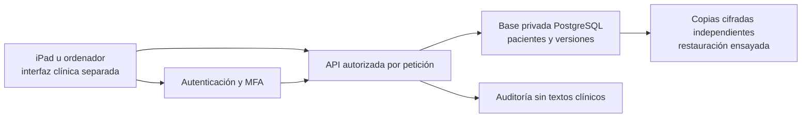

# Paso de demo a aplicación clínica

Fecha: 11 de noviembre de 2026. Estado: diseño y primera base de pacientes bajo pruebas, no autorización para uso clínico.

## Alcance y decisiones

Un profesional usará iPad y ordenador en la Comunitat Valenciana, España. Se conserva la demo 0.11 y su catálogo; se construye otra aplicación/entorno con almacenamiento privado. No se transforman automáticamente los JSON o datos del navegador en historias clínicas reales. No se cambia el aviso de demo para simular seguridad.

Se propone Supabase como candidato para autenticación y PostgreSQL en la UE. La elección definitiva requiere comprobar condiciones y operativa. El plan gratuito sirve para comenzar el desarrollo sin contratar servicios; no se da por resuelta la continuidad clínica, las copias ni la recuperación. El usuario ha creado un proyecto gratuito y ha conectado Supabase. Se han aplicado dos migraciones sin datos clínicos y se han comprobado permisos y rechazo HTTP anónimo. No se ha activado facturación ni se ha conectado la demo a esa base.

## Hallazgos del código publicado

| Área | Evidencia | Cambio necesario para uso real |
| --- | --- | --- |
| Persistencia | `assets/storage.js` y `assets/app.js` leen/escriben `mlrehab-demo-v1` en localStorage | Repositorios remotos por recurso, con autorización y transacciones; no persistir historias ni tokens clínicos en localStorage/IndexedDB |
| Acceso | No hay inicio de sesión ni permisos en servidor | Cuenta admitida explícitamente, MFA obligatorio, revocación y pruebas por petición |
| Copias | `exportData()` descarga JSON legible; importar sustituye todo | Copias operativas cifradas fuera del proveedor, control de claves y ensayo de restauración; importación clínica separada con trazabilidad |
| Conflictos | Comparación local no transaccional | Revisión esperada comprobada en una actualización atómica de base de datos |
| Eliminación | Se borran pacientes/sesiones directamente de los arrays | Archivo y versiones; política de conservación y rectificación antes de cualquier purga |
| Trazabilidad | No hay registro de accesos | Lecturas y escrituras por API auditadas; proteger historial, reloj e identidad y añadir supervisión de fallos |
| Interfaz | Plantillas `innerHTML` y manejadores inline | Revisar todos los puntos de entrada, retirar eventos inline e implantar CSP restrictiva; pruebas de XSS |
| Distribución | GitHub Pages y vistas HTML Preview de terceros | Ninguna historia ni credencial en repositorio/preview; interfaz clínica en origen controlado con cabeceras de seguridad y sin caché de respuestas privadas |
| Informes | Borrador en memoria e impresión del navegador | Permisos, identidad del profesional, revisión, evento de exportación y procedimiento para PDF/impresora/Archivos fuera de la aplicación |

## Arquitectura propuesta

La demo pública puede seguir alojada gratis en GitHub Pages. El origen clínico se evaluará aparte para controlar CSP, `frame-ancestors`, HSTS, `Referrer-Policy`, caché y dependencias. No se abre desde HTML Preview, chats, iframes o un visor de terceros cuando contenga datos reales. No se añadirán analítica o herramientas de grabación de sesión en pantallas clínicas.

La futura interfaz utilizará sesiones breves y control de inactividad. Si se conecta directamente al proveedor, los tokens permanecerán en memoria, sin persistencia del SDK en el navegador; se probarán recarga, revocación y recuperación. Una alternativa con servidor y cookies HttpOnly requiere diseño explícito de CSRF y sesiones. Esta decisión aún no está implementada. MFA no protege por sí sola frente a robo de una sesión o XSS.

El esquema inicial expone solo cinco RPC de pacientes sin elevación (SECURITY INVOKER), que llaman implementaciones privilegiadas en el esquema privado. Las tablas privadas tienen denegación restrictiva y esas implementaciones comprueban cuenta autorizada, `aal2` y propietario en cada operación. No se confía en ocultar botones ni en identificadores enviados por el cliente. No se permite borrado físico por la API.

## Entregas y condición de avance

1. **Base de permisos de pacientes — preparada en esta rama.** Dos migraciones SQL, pruebas PostgreSQL locales e instalación verificada en el proyecto alojado sin datos. No incluye interfaz clínica ni sesiones Auth de usuarios.
2. **Entorno de pruebas y autenticación — siguiente.** Proyecto vacío en UE, configuración contractual revisada, cuenta única admitida, MFA y recuperación de cuenta. Probar accesos reales y separación con dos cuentas ficticias; nada de datos reales.
3. **Migración funcional completa.** Conectar pacientes, agenda, historia, sesiones, tratamientos, catálogo y documentos mediante repositorios remotos y controles de concurrencia. Ninguna ruta debe caer silenciosamente en almacenamiento local si el backend falla. Validar campos y permisos para todos los recursos. Revocar capacidades de importación masiva, borrado y exportación indiscriminada de la demo.
4. **Interfaz y dispositivos.** CSP efectiva, DOM seguro, bloqueo por inactividad, borrado de memoria al salir, sin datos en URL, consola, capturas o caché; ensayar iPad/Safari y ordenador. Si no hay red, rechazar operaciones sin decir que están guardadas. No se activa modo offline clínico en esta fase.
5. **Copias y operación.** Definir con el usuario objetivos de pérdida y recuperación; propuesta inicial para evaluar: RPO máximo 24 h y RTO máximo 8 h, no compromisos ya garantizados. Copias cifradas externas independientes, control y recuperación de claves, avisos ante fallo y ensayo de restauración en proyecto aislado. Versiones y auditoría en la misma base no sustituyen copias externas.
6. **Validación jurídica/organizativa y piloto.** Resolver responsable, información al paciente, base de licitud y excepción aplicable a salud, contratos, conservación, acceso/rectificación y brechas. Evaluar necesidad de EIPD/DPD según el tratamiento y la organización; no inferirla del número de usuarios. Revisar permisos y recuperación con un especialista competente. Solo entonces documentar la decisión de habilitar pacientes reales.

## Operación y límites del proveedor

A la fecha de consulta, Supabase Free anuncia 500 MB y suspensión tras una semana sin actividad; no incluye copias automáticas. El historial de versiones también consume espacio. Empezaremos con datos ficticios, sin activar facturación. Si no se puede garantizar la operación necesaria con las capacidades gratuitas y un procedimiento de copias verificable, habrá que cambiar de plan o proveedor antes del uso real. No se eluden los límites de Free con tareas artificiales.

Seleccionar una región UE para la base no demuestra por sí solo residencia completa de todos los servicios: revisar autenticación, logs, correos, soporte, subencargados y transferencias. DPA, medidas técnicas y certificaciones del proveedor no constituyen una certificación de esta aplicación. No se exige ni promete HIPAA para una consulta española por defecto; si apareciera un ámbito estadounidense, requeriría revisión separada.

En dispositivos: bloqueo del sistema y cifrado configurados, cuentas no compartidas, actualizaciones, autenticador y mecanismo de recuperación protegido. Definir qué hacer ante pérdida del iPad, robo de sesión y falta de servicio. Los PDF descargados y las copias requieren custodia propia: salir de la aplicación no borra un archivo de Archivos o una cola de impresión.

## Normativa y decisiones pendientes en España/Valencia

Los datos de salud son categoría especial: documentar base jurídica del artículo 6 y condición del artículo 9 del RGPD según la actividad. No introducir una casilla de consentimiento como solución universal. Contratos de encargado, seguridad y análisis de riesgos se revisan antes de datos reales.

La Ley 41/2002 regula documentación, acceso y conservación; su artículo 17 contempla un mínimo de cinco años desde el alta de cada proceso asistencial, sin que ello permita fijar una purga general a cinco años. Deben revisarse normativa autonómica, naturaleza de cada documento y otras obligaciones aplicables. La Ley 10/2014 valenciana también aborda historia y acceso. No se implementa purga automática en esta fase.

Un único usuario técnico no acredita ejercicio privado a título individual ni exime automáticamente de obligaciones del centro. La AEPD distingue centros sanitarios y profesionales que ejercen a título individual al tratar la obligación de DPD. La forma jurídica y la organización de la clínica no se han confirmado.

Definir registro de actividades, información y derechos del paciente, acceso de terceros, retención de auditoría y respuesta a incidentes. Para brechas, evaluar notificación conforme al RGPD; el plazo de 72 h para la autoridad aplica cuando procede, no significa notificar toda incidencia ni sustituye la investigación.

## Fuentes oficiales consultadas

- [RGPD, texto oficial de la UE](https://eur-lex.europa.eu/legal-content/ES/TXT/?uri=CELEX:32016R0679): artículos 5, 6, 9, 25, 28, 32–35.
- [AEPD: guía para profesionales sanitarios](https://www.aepd.es/guias/guia-profesionales-sector-sanitario.pdf) y [acceso justificado a historias](https://www.aepd.es/preguntas-frecuentes/16-salud/1-usuarios-sanidad/FAQ-1625-puede-acceder-a-mis-datos-cualquier-medico-o-personal-sanitario).
- [AEPD: obligación de DPD en sanidad](https://www.aepd.es/preguntas-frecuentes/16-salud/1-usuarios-sanidad/FAQ-1630-estan-obligados-los-centros-sanitarios-a-tener-un-delegado-de-proteccion-de-datos).
- [Ley 41/2002, BOE](https://www.boe.es/buscar/act.php?id=BOE-A-2002-22188) y [Ley 10/2014 de Salud de la Comunitat Valenciana](https://www.boe.es/buscar/act.php?id=BOE-A-2015-1239).
- [Supabase: seguridad de producción](https://supabase.com/docs/guides/security/production-checklist), [MFA](https://supabase.com/docs/guides/auth/auth-mfa), [regiones](https://supabase.com/docs/guides/platform/regions), [precios](https://supabase.com/pricing), [copias](https://supabase.com/docs/guides/platform/backups), [DPA](https://supabase.com/legal/customer-resources/data-processing-addendum) y [residencia/transferencias](https://supabase.com/legal/privacy-resources/data-residency-and-transfers-faq).

Este documento identifica trabajo técnico y decisiones que deben verificarse; no declara cumplimiento legal ni seguridad clínica completa.
